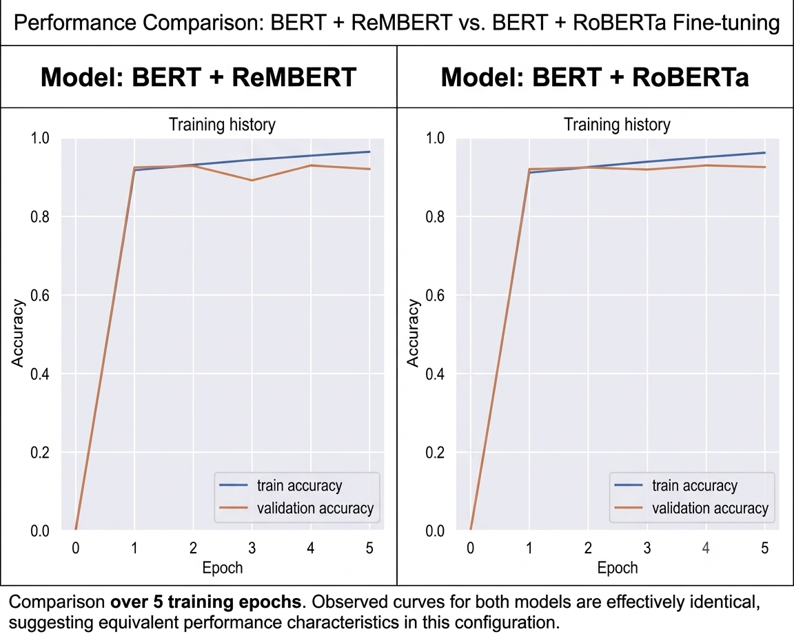

# Audio-Enabled Hate Speech Detection & Real-Time Content Sanitization Pipeline

## 📋 Overview

Online communication platforms frequently encounter toxic, abusive, and hateful language. Traditional moderation systems often focus exclusively on text, limiting their ability to process spoken communication directly.

This project implements an **end-to-end audio-enabled content moderation pipeline** that converts speech into text, detects toxic content using transformer-based classification models, sanitizes inappropriate language, and generates cleaned speech using Text-to-Speech (TTS).

The system integrates **BERT, RoBERTa, and RemBERT** transformer architectures to classify harmful language and support automated content moderation. Flagged words can be replaced with a **2 kHz sinusoidal beep** in the audio output, while the sanitized transcript can be converted back into speech.

### Key Features

- **Audio Input Processing:** Supports speech recordings in `.wav` and `.mp3` formats.
- **Automatic Speech Recognition (ASR):** Converts spoken audio into text for downstream classification.
- **Transformer-Based Classification:** Uses BERT, RoBERTa, and RemBERT for contextual toxicity detection.
- **Comparative Model Evaluation:** Compares two transformer combinations to assess classification performance.
- **Content Sanitization:** Identifies flagged vocabulary and replaces corresponding audio segments with a 2 kHz beep signal.
- **Text-to-Speech Synthesis:** Generates spoken output from the sanitized transcript.
- **Training Visualization:** Displays training and validation accuracy curves for model evaluation.

---

## 🛠️ Project Architecture & Structure

```text
├── assets/
│   └── sample_speech.wav
│       # Input audio samples (.wav / .mp3)
│
├── BERT_REMBERT.ipynb
├── BERT_ROBERTA.ipynb
├── Hate_Speech_Detection.py
│       # Complete training and inference pipeline
│
├── outputs/
│   └── training_history.png
│       # Training and validation accuracy curves
│
├── requirements.txt
│   # Project dependencies
│
└── README.md
    # Project documentation
```

---

## ⚙️ Methodology

### 1. Audio Input Handling and Speech Recognition

The pipeline accepts recorded speech as input and converts it into a textual transcript using Automatic Speech Recognition (ASR).

The generated transcript serves as the input for subsequent text preprocessing and toxicity classification.

**Input:** Audio recording (`.wav` or `.mp3`)

**Output:** Recognized text transcript

### 2. Text Preprocessing and Tokenization

The recognized transcript is prepared for transformer-based classification.

The preprocessing stage includes:

- Text normalization and cleaning.
- Tokenization using the selected transformer's tokenizer.
- Conversion of text into token IDs and attention masks.
- Preparation of model-compatible input representations.

Transformer tokenization and contextual representations help the models capture linguistic patterns relevant to toxicity detection.

### 3. Dual-Model Transformer Classification

The system evaluates two transformer combinations:

- **Pipeline Model A:** BERT + RoBERTa
- **Pipeline Model B:** BERT + RemBERT

These combinations are designed to leverage contextual language representations for detecting different categories of inappropriate content.

The classification output can include categories such as:

- No Toxicity
- Obscene
- Severe Toxic & etc

The actual labels depend on the dataset and the classification mapping implemented in the notebook.

### 4. Real-Time Content Sanitization

After classification, the pipeline identifies the words or phrases flagged for moderation.

The sanitization component replaces the corresponding audio segments with a **2 kHz sinusoidal beep signal**, helping conceal inappropriate spoken content while retaining the surrounding speech.

The intended processing workflow is:

1. Detect and classify inappropriate language.
2. Identify the corresponding word or phrase in the transcript.
3. Align the flagged text with its position in the original audio.
4. Replace the relevant audio interval with the beep signal.
5. Preserve the remaining speech and produce the sanitized output.

Accurate word-level timestamps or forced alignment are important for replacing only the intended audio segments.

### 5. Text-to-Speech (TTS) Synthesis

The sanitized transcript can be passed to a Text-to-Speech engine to generate a clean spoken version of the moderated content.

This provides an alternative audio output for applications where users need to listen to moderated speech rather than read the transcript.

The synthesized speech and beep-sanitized original audio are distinct output approaches; the exact output behavior depends on the implementation.

---

## 📈 Model Performance & Comparative Benchmarks

The following table presents the reported validation accuracy values for the two transformer combinations.

| Model Architecture | Transformer Combination | Validation Accuracy | Key Capability |
|---|---|---:|---|
| Pipeline Model A | BERT + RoBERTa | 92.0% | Contextual feature extraction and toxicity classification |
| **Pipeline Model B** | **BERT + RemBERT** | **97.0%** | Contextual classification with multilingual modeling potential |

### Key Findings

- **Reported best performance:** Pipeline Model B achieves a validation accuracy of 97.0%.
- **Comparative evaluation:** Pipeline Model A provides a baseline for comparing the alternative transformer combination.
- **Contextual language understanding:** Transformer models capture contextual information that can be useful for distinguishing harmful language from ordinary speech.
- **Multilingual potential:** RemBERT is designed for multilingual language understanding, although actual performance depends on the languages represented in the training and evaluation datasets.

---

## 📉 Execution Visualizations & Inference Examples

### 1. Training and Validation History

**File:** `assets/training_history.png`

This visualization displays the evolution of training and validation accuracy across epochs. It can help assess convergence, identify potential overfitting, and compare model learning behavior.



### 2. Live Inference and Toxicity Classification

The prediction engine classifies text into the categories supported by the trained model.

#### Example 1: Severe Toxic Content

```python
prediction_model("i wanna kill you!!!!")
```

**Expected output:**

```text
Detected sentiment: Severe Toxic
```

#### Example 2: Non-Toxic Content

```python
prediction_model("i love myself!!!!")
```

**Expected output:**

```text
Detected sentiment: No Toxicity
```

#### Example 3: Obscene or Abusive Content

```python
prediction_model("she is a pathetic")
```

**Expected output:**

```text
Detected sentiment: Obscene
```

---

## 🚀 Quickstart & Execution Guide

### Prerequisites

- Python 3.8 or a compatible Python version supported by the installed dependencies.
- Jupyter Notebook.
- A compatible environment for running the selected transformer models.
- Audio samples in `.wav` or `.mp3` format.

### Installation

**1. Clone the repository**

```bash
git clone <https://github.com/TheRabiyaQuadri/hate-speech-detection-transformer>
cd <hate-speech-detection-transformer>
```

Replace the placeholders with your actual repository URL and directory name.

**2. Install dependencies**

```bash
pip install -r requirements.txt
```

Ensure that the requirements file includes the libraries used by the notebook, such as the applicable transformer framework, audio processing tools, ASR implementation, and TTS engine.

**3. Prepare the input audio**

Place your audio files inside the `assets/` directory.

```text
assets/
└── sample_speech.wav
```

**4. Launch Jupyter Notebook**

```bash
jupyter notebook notebooks/hate_speech_detection.ipynb
```

**5. Execute the pipeline**

Run the notebook cells sequentially to perform:

1. Audio loading and speech transcription.
2. Transcript preprocessing and tokenization.
3. Transformer-based toxicity classification.
4. Identification of flagged content.
5. Audio sanitization using the 2 kHz beep signal.
6. Text-to-Speech synthesis and output generation.
7. Evaluation and visualization of model performance.

---

## 🧰 Technologies Used

- **Python** — Core programming language
- **Jupyter Notebook** — Experimentation and pipeline execution
- **BERT** — Contextual language representation
- **RoBERTa** — Transformer-based text classification
- **RemBERT** — Multilingual transformer-based language modeling
- **Automatic Speech Recognition (ASR)** — Speech-to-text transcription
- **Text-to-Speech (TTS)** — Generation of spoken output
- **Audio Processing Libraries** — Audio loading, manipulation, and beep insertion
- **Matplotlib** — Training and evaluation visualization

---

## 🔬 Future Improvements

Potential extensions include:

- **Word-Level Audio Alignment:** Improve timestamp accuracy when identifying flagged words in spoken recordings.
- **Multilingual Toxicity Detection:** Evaluate performance across different languages, accents, and code-switching patterns.
- **Real-Time Streaming Moderation:** Process incoming audio continuously with low-latency transcription and classification.
- **Advanced Evaluation Metrics:** Report macro-F1, class-wise precision and recall, ROC-AUC where appropriate, and confusion matrices.
- **Context-Aware Moderation:** Distinguish direct threats and abusive speech from quotations, sarcasm, and legitimate discussions of harmful topics.
- **Speaker-Aware Processing:** Explore speaker diarization for conversations involving multiple participants.
- **Robustness Testing:** Evaluate performance under background noise, varied recording quality, and ASR transcription errors.

---

## 👤 Author

Developed as an audio-enabled content moderation project exploring transformer-based toxicity detection, speech processing, and automated audio sanitization.
